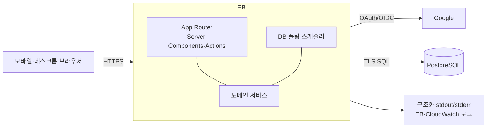
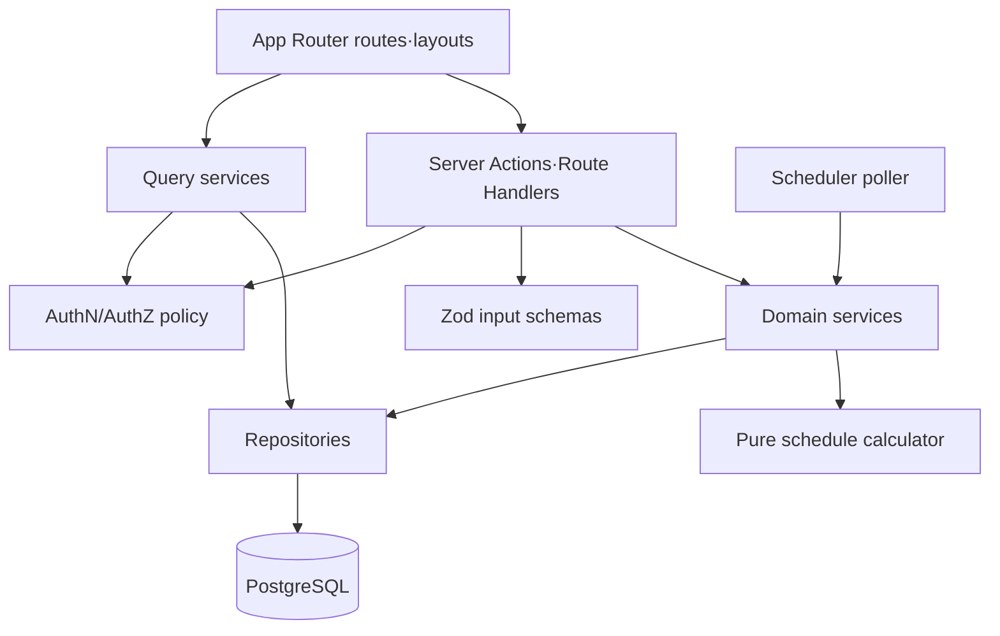
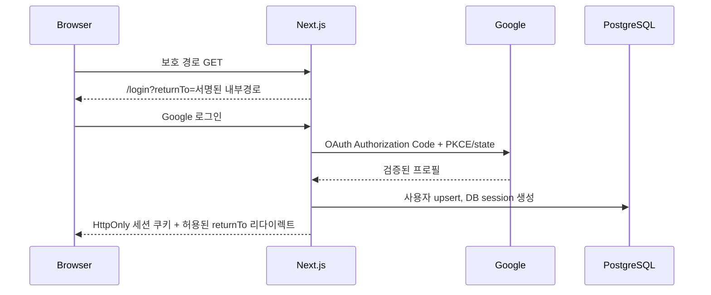
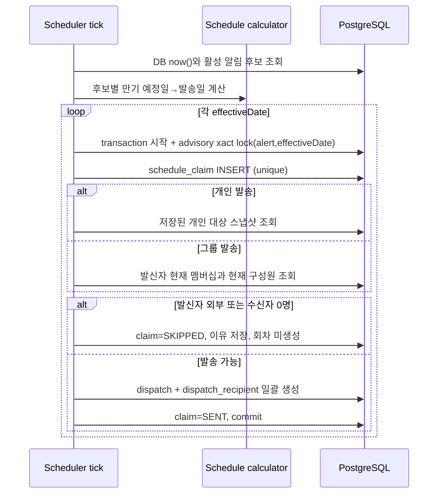
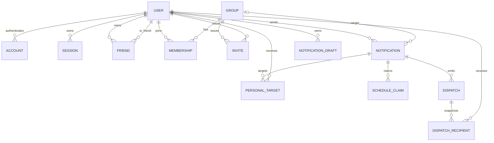

# 설계 문서

## Overview

개인·그룹 알림 서비스는 Next.js App Router와 TypeScript로 구현하고 AWS Elastic Beanstalk(EB)의 하나의 웹 애플리케이션으로 배포하는 모바일 우선 MVP다. 같은 Node.js 프로세스가 웹 요청을 처리하고 DB 폴링 스케줄러를 시작한다. 웹 서버와 스케줄러가 둘 이상 실행되어도 PostgreSQL 트랜잭션 잠금과 고유 제약이 발송 회차의 중복 생성을 막는다.

이 설계의 기준 자료는 다음과 같다.

- 기능·권한 기준: `.kiro/specs/personal-group-notifications/requirements.md`
- 화면·문구·시각 기준: `ui-design-with-screens/ui-design.md`
- 화면 구현 기준: `ui-design-with-screens/screens/*.html`
- 배포 기준: `.github/workflows/deploy.yml`의 Node.js 26, `next start`, `PORT`, `ap-northeast-2`, lint/typecheck/test/build 단계

### 목표와 범위

- Google OAuth만으로 가입·로그인하고 DB 세션을 사용한다.
- 친구, 그룹, 초대, 그룹별 이메일 공개, 탈퇴와 재가입 이력을 관리한다.
- 개인 또는 그룹 한 종류에만 일회성·반복 알림을 예약한다.
- Asia/Seoul 달력 규칙으로 회차를 계산하고 주말 이동 및 같은 발송일 중복을 제거한다.
- 발송 시점의 수신자를 스냅샷으로 보존하고 명시적 확인 버튼만 상태를 바꾼다.
- 현재 멤버십과 가장 최근 가입 시점에 따라 서버에서 모든 조회·변경 권한을 검사한다.
- 받은 알림은 회차별 카드로, 보낸 알림은 알림별 카드로 제공한다.

MVP는 앱 내부 알림만 다룬다. 이메일·모바일 푸시, 친구 삭제/승인, 그룹 관리자 역할, 초대 만료/폐기, 알림 수정/삭제, 반복 종료일은 포함하지 않는다.

### 조사 결과와 설계에 반영한 제약

외부 최신 정보가 필요하지 않아 웹 검색은 수행하지 않았다. 저장소 자료를 조사해 다음을 설계에 반영했다.

1. 배포 워크플로는 루트 앱, 잠금 파일, `npm ci`, `next typegen`, TypeScript 검사, 테스트, 기본 Next.js 서버 빌드를 요구한다. 따라서 별도 워커 배포나 외부 큐 없이 `next start`와 PostgreSQL만으로 동작하게 한다.
2. UI 명세는 390×844px 모바일 화면과 고정 디자인 토큰을 확정했다. HTML 시안은 구조·간격의 기준이고, 인라인 스타일을 복사하지 않고 토큰 기반 CSS Modules 또는 전역 CSS 변수로 옮긴다.
3. `Detail.html`은 과거의 알림 상세 시안이다. 확정 명세 5장과 요구사항 12.2가 상세 화면을 제거했으므로 구현하지 않는다. 받은 카드에서 확인과 응답 현황 이동을 모두 처리한다.
4. `Status.html`은 응답 현황의 구현 기준이지만 `보낸 알림` 탭의 목록 시안은 없다. 요구사항 17에 따라 별도 보낸 알림 목록을 설계한다.
5. EB는 교체 배포나 스케일 아웃 중 여러 프로세스가 겹칠 수 있다. 프로세스 내부 타이머만으로 정확성을 보장하지 않고 DB를 유일한 조정 지점으로 사용한다.

### 핵심 설계 결정

| 결정 | 선택 | 근거 |
|---|---|---|
| 애플리케이션 | Next.js App Router + TypeScript strict | 서버 렌더링, Server Action, 단일 배포를 한 코드베이스에서 처리 |
| 인증 | Auth.js Google Provider + PostgreSQL Adapter의 database session | Google 전용 로그인, 서버에서 즉시 폐기 가능한 세션, 다중 인스턴스 공유 |
| 데이터 접근 | Prisma ORM + SQL migration | 타입 안전한 일반 질의와 partial unique index/advisory lock용 SQL을 함께 사용 |
| 일정 계산 | Luxon 기반 순수 도메인 함수, zone 고정 `Asia/Seoul` | 달력 날짜·요일·월말·KST 변환을 명시적으로 처리하고 속성 테스트 가능 |
| 스케줄러 | Next.js `instrumentation.ts`에서 production Node 런타임 폴러 시작 | 현재 `next start` Procfile을 유지하는 단일 배포. DB 잠금으로 프로세스 수와 무관하게 안전 |
| 쓰기 경계 | Server Action → 인증/검증 → 도메인 서비스 → DB transaction | 폼 중심 UI에 맞고 오류 계약을 통일 |
| 읽기 경계 | Server Component의 query service | 민감 데이터를 브라우저 API 응답에 과다 노출하지 않고 초기 렌더 왕복 감소 |
| 정확히 한 번 효과 | 발송 슬롯 claim + transaction advisory lock + unique index | 타이머 중복, 재시작, 동시 실행에도 회차/수신자 중복 방지 |

## Architecture

### 시스템 문맥



### 런타임과 배포

- `next.config.ts`는 Node.js 서버 런타임을 사용한다. 인증, 스케줄러, PostgreSQL 접근 경로에는 Edge 런타임을 사용하지 않는다.
- 워크플로가 만드는 `web: ./node_modules/.bin/next start -H 0.0.0.0 -p ${PORT:-8080}`를 유지한다.
- `instrumentation.ts`의 `register()`는 `NEXT_RUNTIME === 'nodejs'`이고 `NODE_ENV === 'production'`일 때 스케줄러 모듈을 한 번 시작한다. 개발 중 HMR 중복은 `globalThis` 플래그로 막지만 정확성은 DB가 보장한다.
- 폴러는 기본 30초마다 DB 시간을 기준으로 만기 슬롯을 조회한다. 한 틱의 처리량과 실행 시간을 제한하고, 다음 틱과 겹쳐도 안전하다.
- 정상 종료 신호에서 새 폴링을 중단한다. 진행 중 트랜잭션은 완료하거나 DB 연결 종료로 롤백되어 다음 프로세스가 재시도한다.
- 앱 시작 자체는 DB migration을 실행하지 않는다. CI/CD의 별도 명시적 migration 단계에서 `prisma migrate deploy`를 실행하도록 구현 단계에서 배포 워크플로를 확장해야 한다. migration 실패 시 새 버전을 서비스하지 않는다.
- `/api/health/live`는 프로세스 생존만, `/api/health/ready`는 제한 시간 내 `SELECT 1`과 migration 호환성을 검사한다. 민감한 설정이나 DB 오류 원문은 반환하지 않는다.

### 계층과 의존 방향



- `domain/`은 일정 계산, 대상 검증, 조회 범위 판정처럼 프레임워크와 DB에서 분리할 수 있는 규칙을 가진다.
- `application/`은 유스케이스와 트랜잭션 경계를 소유한다.
- `infrastructure/`는 Prisma repository, Auth.js adapter, scheduler loop, 로깅을 소유한다.
- `app/`과 `components/`는 라우팅, 서버 데이터 로딩, 폼, 접근 가능한 표현을 소유한다.
- 클라이언트가 전달한 사용자 ID, 발신자 ID, 멤버 수, 수신 예정 수, 응답 집계는 신뢰하지 않는다. 세션 사용자와 DB 스냅샷에서 다시 계산한다.

### 주요 처리 흐름

#### 로그인과 원래 경로 복귀



`returnTo`는 동일 origin의 `/`로 시작하는 허용 경로만 받는다. 외부 URL, 스킴 상대 URL, 제어 문자가 있는 값은 `/inbox`로 대체한다. 신규 Google 프로필 이름이 닉네임 규칙을 만족하지 않으면 `/profile/setup`으로 보낸 뒤 원래 경로로 이동한다.

#### 발송 회차 생성



`ScheduleClaim(alertId, effectiveDate)`의 고유 제약은 같은 날짜 슬롯을 한 번만 확정한다. 트랜잭션 안에서 claim, 회차, 수신자 스냅샷을 함께 기록하므로 중간 실패는 모두 롤백된다. `Dispatch(alertId, effectiveDate)`와 `DispatchRecipient(dispatchId, recipientId)`에도 방어적 고유 제약을 둔다.

#### 확인 처리

확인 Action은 세션 사용자로 수신자 스냅샷을 찾고, 그룹 발송이면 현재 활성 멤버십도 검사한다. 다음 조건부 갱신만 수행한다.

```sql
UPDATE dispatch_recipient
SET confirmed_at = transaction_timestamp()
WHERE dispatch_id = $1
  AND recipient_id = $sessionUser
  AND confirmed_at IS NULL;
```

갱신 행이 1개면 최초 확인, 0개이면서 허용된 수신자이고 이미 시간이 있으면 멱등 성공이다. 허용되지 않은 사용자는 403이다. 카드 조회만으로 이 갱신 경로를 호출하지 않는다.

## Components and Interfaces

### 디렉터리 책임

```text
app/
  (public)/login/page.tsx
  (public)/invite/[token]/page.tsx
  (protected)/layout.tsx
  (protected)/profile/setup/page.tsx
  (protected)/inbox/page.tsx
  (protected)/sent/page.tsx
  (protected)/friends/page.tsx
  (protected)/groups/page.tsx
  (protected)/groups/[groupId]/page.tsx
  (protected)/notifications/new/page.tsx
  (protected)/notifications/new/schedule/page.tsx
  (protected)/notifications/[notificationId]/status/page.tsx
  api/auth/[...nextauth]/route.ts
  api/health/live/route.ts
  api/health/ready/route.ts
  actions/*.ts
components/
  ui/*
  navigation/*
  notifications/*
  groups/*
domain/
  authz.ts, email.ts, nickname.ts, schedule.ts, recipients.ts
application/
  commands/*, queries/*
infrastructure/
  db.ts, auth.ts, logger.ts, scheduler/*
```

실제 파일 분리는 구현 중 조정할 수 있지만 의존 방향과 권한 경계는 유지한다.

### 인증·인가 정책

모든 보호 Route, Server Action, query service는 `requireUser()`로 유효한 DB 세션과 사용자를 가져온다. 미들웨어는 빠른 리다이렉트에만 쓰며 최종 권한 판단 수단으로 사용하지 않는다.

| 정책 함수 | 허용 조건 | 실패 |
|---|---|---|
| `canViewGroup(groupId, userId)` | `leftAt IS NULL`인 현재 멤버십 존재 | 403/권한 없음 화면 |
| `canIssueInvite` | 현재 그룹 구성원 | 403 |
| `canSendGroup` | 등록 시점과 각 회차 생성 시점 모두 현재 구성원 | 등록 403, 회차 `SKIPPED_SENDER_NOT_MEMBER` |
| `canViewPersonalDispatch` | 알림 발신자 또는 해당 회차 수신자 | 제3자 403 |
| `personalStatusScope` | 발신자는 전체, 수신자는 자기 행만 | 서버 query에서 projection 제한 |
| `canViewGroupDispatch` | 현재 구성원이고 `dispatch.sentAt >= latestMembership.joinedAt` | 가입 전 403/조회 불가, 외부 403 |
| `canConfirm` | 회차 수신자이며 그룹 발송이면 현재 구성원 | 403, 어떤 응답 행도 변경하지 않음 |

그룹 관련 권한은 알림 발신자에게도 예외를 주지 않는다. 재가입 시 `latestMembership`은 새 이력 행이며 이전 가입 기간의 회차는 볼 수 없다. 목록 query에도 같은 predicate를 넣어 숨김과 직접 URL 접근을 일치시킨다.

### 입력 계약과 공통 결과

Server Action은 `FormData`를 그대로 도메인에 넘기지 않고 Zod schema로 파싱한다. 모든 쓰기 Action의 반환 형태는 다음과 같다.

```ts
type ActionResult<T = undefined> =
  | { ok: true; data: T; message?: string }
  | {
      ok: false;
      code:
        | 'VALIDATION_ERROR'
        | 'UNAUTHENTICATED'
        | 'FORBIDDEN'
        | 'NOT_FOUND'
        | 'CONFLICT'
        | 'OAUTH_ERROR'
        | 'INTERNAL_ERROR';
      message: string;
      fieldErrors?: Record<string, string[]>;
      requestId: string;
    };
```

- 성공 후 서버에서 필요한 route를 `revalidatePath`하고, 생성/수락/예약처럼 화면 전환이 필요한 경우에만 `redirect`한다.
- 예상 가능한 오류는 사용자용 한국어 메시지와 안정된 `code`로 반환한다. DB/Google 오류 원문, ID 존재 여부, stack trace는 노출하지 않는다.
- 변경 Action은 Origin/Host 검사를 통과한 동일 사이트 POST와 유효 세션에서만 실행한다. Auth.js state/PKCE와 `SameSite=Lax`, `HttpOnly`, `Secure` 쿠키를 사용한다.

### Server Action 계약

| Action | 입력 | 성공 결과 | 서버 검증·원자성 |
|---|---|---|---|
| `updateNickname` | `nickname` | 정규화된 닉네임 | trim 후 1~20 Unicode code points, 사용자 행 갱신 |
| `signOutUser` | 없음 | 로그인 화면 | DB session 폐기 |
| `addFriend` | `email` | 추가 친구 요약 | 기본 형식, 소문자 정규화, 가입자·타인·비중복; `(ownerId, friendId)` unique |
| `createGroup` | `name` | `groupId` | trim 비어 있음 거부; 그룹과 생성자 멤버십을 한 transaction으로 생성 |
| `copyInviteFeedback` | 클라이언트 clipboard 결과 | UI 메시지만 | 링크 자체 발급은 `getOrCreateInvite`가 권한 검사; 복사는 브라우저 기능 |
| `acceptInvite` | `rawToken` | `groupId` | token hash 조회, 활성 멤버십 중복이면 멱등 안내; 새 membership 이력 생성 |
| `leaveGroup` | `groupId`, `confirmation=true` | 탈퇴 시각 | 현재 membership을 조건부 종료; 취소는 Action 호출 없이 닫기 |
| `setGroupEmailVisibility` | `groupId`, `PUBLIC|PRIVATE` | 저장 값 | 현재 membership 한 행만 갱신 |
| `createNotificationDraft` | 문장, `PERSONAL|GROUP`, 개인 대상 IDs 또는 groupId | 서명/세션 결합 draft key | 문장 trim 비어 있음 거부, 대상 종류 XOR, 친구/멤버십 재검증 |
| `scheduleNotification` | draft key, 일회/반복 설정 | `notificationId` | draft 소유자 확인, 일정을 KST로 검증, 알림·대상 transaction 생성 |
| `stopRecurringNotification` | `notificationId` | 중지 시각 | 발신자만, ACTIVE 반복만 조건부 갱신; 기존 회차 유지 |
| `confirmDispatch` | `dispatchId` | 최초 또는 기존 `confirmedAt` | 수신자·현재 그룹 권한 검사 후 조건부 갱신, 멱등 |

작성 1단계 draft는 URL query에 개인정보를 넣지 않는다. 짧은 수명의 HttpOnly 암호화 세션 값 또는 DB `notification_draft`(소유자, 만료 시각)로 보관한다. MVP에서는 검증과 새로고침 복원을 위해 DB draft를 사용하며 예약 성공 시 소비 처리한다.

### Query 계약

| Query | 반환 projection | 필수 필터 |
|---|---|---|
| `getFriends(userId)` | 닉네임, 이메일 | owner가 세션 사용자 |
| `getGroups(userId)` | 그룹 ID·이름, 현재 구성원 수, 최근 발송일 | 현재 membership만 |
| `getGroupDetail(groupId, userId)` | 초대 URL, 내 공개 설정, 구성원 닉네임과 허용 이메일 | 요청자 현재 구성원; 각 구성원 공개 설정 적용 |
| `getInvite(rawToken, viewer?)` | 그룹명, 초대자 닉네임, 현재 인원, 현재 가입 여부 | token hash로만 조회; 잘못된 token은 일반 오류 |
| `getComposeOptions(userId, mode)` | 친구 또는 현재 그룹 목록 | 세션 사용자 소유/멤버십 |
| `getInbox(userId)` | 회차별 카드, 자기 응답만 | 수신자 스냅샷 + 개인, 또는 현재 그룹 권한을 만족한 그룹 회차 |
| `getSent(userId)` | 알림별 카드, 일정 요약, 최근 조회 가능 회차 집계 | 발신자; 그룹 알림은 현재 멤버인 것만 |
| `getStatus(notificationId, dispatchId?, userId)` | 회차 selector와 선택 회차 projection | 개인/그룹 정책 적용; 가입 전 selector는 메타만 비활성 노출 |

응답 현황의 확인 수와 전체 수는 `dispatch_recipient` 스냅샷에서 같은 query/transaction snapshot으로 집계한다. 개인 수신자에게는 다른 수신자의 닉네임, 상태, 확인 시각을 select하지 않는다.

### 라우트·화면·HTML 시안 연결

| Route | 화면/컴포넌트 | 구현 기준 |
|---|---|---|
| `/login` | `LoginScreen`, `GoogleSignInButton` | `Main.html`의 앱 아이콘·3줄 헤드라인·하단 로그인 묶음 |
| `/friends` | `FriendsPage`, `AddFriendCard`, `FriendList`, `EmptyState` | `Friends.html` |
| `/groups` | `GroupsPage`, `CreateGroupCard`, `GroupList`, `EmptyState` | `Groups.html` |
| `/groups/[groupId]` | `GroupDetailPage`, `InviteLinkCard`, `EmailVisibilitySwitch`, `MemberList`, `LeaveGroupDialog` | `GroupDetail.html` |
| `/invite/[token]` | `InvitePage`, `InviteBenefits`, 수락/나중에 | `Invite.html` |
| `/notifications/new?mode=personal` | `ComposePersonalForm` | `ComposePersonal.html` |
| `/notifications/new?mode=group` | `ComposeGroupForm`, `RecipientPreview` | `ComposeGroup.html` |
| `/notifications/new/schedule` | `ScheduleForm`, `SchedulePreview` | `Schedule.html` |
| `/inbox` | `InboxPage`, `ReceivedDispatchCard` | `Inbox.html`; 별도 상세 route 없음 |
| `/notifications/[id]/status` | `StatusPage`, `DispatchSelector`, `ResponseProgress`, `RecipientStatusList` | `Status.html` |
| `/sent` | `SentPage`, `SentNotificationCard` | 요구사항 17과 공통 카드/탭 토큰으로 신규 설계 |
| 없음 | 과거 알림 상세 | `Detail.html`은 확정 명세와 충돌하므로 구현하지 않음 |

`/sent`는 큰 제목 “보낸 알림”, 알림별 카드, 알림 문장, 개인/그룹 배지, 일정 요약, 최근 회차 `확인 M/N`, “응답 현황” 버튼을 표시한다. 그룹에서 탈퇴한 알림은 목록 query에서 제외한다. 카드 선택과 버튼 모두 같은 응답 현황 route로 이동하되 중첩 interactive element는 만들지 않는다.

### 시각 시스템, 반응형, 접근성

- `:root` CSS 변수로 `--bg:#F3F5F7`, `--surface:#FFFFFF`, `--text:#17202B`, `--text-sub:#5B6675`, `--text-mid:#46505E`, `--accent:#1F5FE0`, `--accent-soft:#E6ECF5`, `--line:#E9ECF0`, `--neutral-btn:#E1E5EA`, `--toggle-off:#8A93A0`를 선언한다.
- 서체, 크기, 굵기, 20px 카드 radius, 16px 주요 버튼 radius, 간격, 44px 최소 터치 영역은 UI 명세 값을 그대로 쓴다. 카드에는 border/shadow를 넣지 않고 segmented control 선택 조각에만 지정 그림자를 쓴다.
- viewport 390px에서 시안과 같은 단일 열이다. 본문은 `width:min(100%, 640px); margin-inline:auto`로 넓은 화면에서도 읽기 폭을 제한한다. 768px 이상에서는 하단 고정 버튼/탭도 같은 640px 컨테이너에 맞추며 데이터 의미나 순서를 바꾸지 않는다.
- `100dvh`, safe-area inset, 하단 action/tab 높이만큼 content padding을 사용해 iOS 주소창과 홈 표시줄에 가리지 않게 한다. 작은 높이에서는 본문만 스크롤한다.
- 모든 입력은 보이는 `<label>`과 오류 `aria-describedby`를 갖는다. 오류 요약은 `role="alert"`, 저장/복사 성공은 `role="status" aria-live="polite"`로 알린다.
- 토글은 `button role="switch" aria-checked`, segmented control은 radio group, 친구 선택은 checkbox, 그룹 선택은 radio, 탈퇴 확인은 focus-trap을 갖춘 dialog로 구현한다.
- 회차 선택기는 키보드 화살표 이동이 가능한 radio group 또는 tablist로 구현한다. 조회 불가 항목은 비활성 상태와 “조회 불가” 텍스트를 함께 제공한다.
- 상태는 색만으로 구분하지 않고 “확인/미확인”, 아이콘, 확인 시각을 함께 표시한다. 포커스 링은 accent와 충분히 구분되는 2px outline을 제공하고 `prefers-reduced-motion`에서 비필수 전환을 제거한다.
- 한글 문장과 닉네임 확대 200%, 긴 그룹명·이메일·알림 문장에서 레이아웃이 잘리거나 가로 스크롤되지 않게 `overflow-wrap:anywhere`와 말줄임의 접근 가능한 전체 이름을 제공한다.

### 빈 상태, 오류, 권한 없음, 로딩

| 상태 | 표현 | 동작 |
|---|---|---|
| 친구 없음 | “아직 친구가 없어요” + 이메일 추가 설명 | 같은 화면의 추가 입력으로 초점 이동 |
| 그룹 없음 | “아직 속한 그룹이 없어요” | 그룹 이름 입력으로 초점 이동 |
| 받은 알림 없음 | “받은 알림이 없어요” | “새 알림 작성” |
| 보낸 알림 없음 | “보낸 알림이 없어요” | “새 알림 작성” |
| 입력 오류 | 해당 필드 아래 구체적 문구 + 상단 요약 | 입력값 유지, 첫 오류에 초점 |
| 데이터 로딩 | 실제 카드 크기의 무동작 skeleton | `aria-busy=true`, 스크린리더용 “불러오는 중” |
| 일시 오류 | “정보를 불러오지 못했어요” + 다시 시도 | route `error.tsx`, requestId 표시 |
| 404 | 자원 존재를 확인할 수 없다는 일반 문구 | 안전한 목록으로 이동 |
| 그룹 외부/탈퇴 | “조회 권한 없음” 전용 상태, 알림 문장·구성원·응답 미표시 | 그룹/받은 알림으로 이동 |
| 가입 전 회차 | selector 메타만 비활성 “조회 불가”; 직접 접근 시 본문 없음 | 조회 가능한 회차 선택 |
| 잘못된 초대 | “유효하지 않은 초대예요”, 그룹 정보 미표시 | 받은 알림으로 이동 |
| OAuth 실패/취소 | 계정 미생성, 일반 로그인 실패 문구 | Google 로그인 다시 시도 |

Suspense fallback과 `loading.tsx`는 읽기 화면에만 사용한다. 쓰기 버튼은 제출 중 비활성화하고 진행 문구를 제공하지만 클라이언트 비활성만 신뢰하지 않고 서버 멱등성/고유 제약을 적용한다.

## Data Models

모든 PK는 추측하기 어려운 UUID/UUIDv7 계열을 사용한다. 시각은 `timestamptz`로 저장하고 PostgreSQL과 애플리케이션 연결은 UTC를 기본으로 한다. 일정의 달력 날짜와 시각은 별도 `date`/`time` 의미 값으로 저장한 뒤 `Asia/Seoul`에서 instant로 변환한다. 이메일은 원문 표시값과 비교용 소문자 정규화 값을 분리한다.

### 열거형

```ts
type EmailVisibility = 'PRIVATE' | 'PUBLIC';
type DeliveryMode = 'PERSONAL' | 'GROUP';
type ScheduleKind = 'ONE_TIME' | 'RECURRING';
type Recurrence = 'DAILY' | 'WEEKLY' | 'MONTHLY';
type NotificationState = 'ACTIVE' | 'STOPPED';
type ClaimState = 'SENT' | 'SKIPPED';
type SkipReason = 'SENDER_NOT_MEMBER' | 'NO_RECIPIENTS';
```

응답 상태는 중복 저장하지 않고 `confirmedAt IS NULL`이면 `미확인`, 값이 있으면 `확인`으로 파생한다.

### 관계 모델



### 테이블 정의

#### 인증과 사용자

- `User(id, emailOriginal, emailNormalized, nickname, nicknameRequired, createdAt, updatedAt)`
  - `emailNormalized` unique, non-null. Google이 검증한 이메일만 계정 키로 사용한다.
  - 닉네임은 trim 후 1~20 code points check를 애플리케이션과 DB check로 이중 검증한다.
- `Account`, `Session`, `VerificationToken`: Auth.js adapter 호환 스키마다. `Session.sessionToken` unique, `expires` index. Google provider만 설정한다.

#### 친구와 그룹

- `Friend(ownerId, friendId, createdAt)`
  - PK/unique `(ownerId, friendId)`, `CHECK(ownerId <> friendId)`, 양쪽 FK `User`.
  - 단방향 관계이며 반대 방향 행을 자동 생성하지 않는다.
- `Group(id, name, createdById, createdAt)`
  - name은 trim된 비어 있지 않은 문자열이다.
- `Membership(id, groupId, userId, joinedAt, leftAt, emailVisibility, createdAt)`
  - 가입 이력을 보존한다. 현재 membership은 `leftAt IS NULL`이다.
  - SQL migration으로 `UNIQUE(group_id, user_id) WHERE left_at IS NULL` partial index를 만든다.
  - `(groupId, userId, joinedAt DESC)` index로 최신 가입 시점을 찾는다.
  - 재가입은 이전 행을 되살리지 않고 `PRIVATE`인 새 행을 만든다.
- `Invite(id, groupId, issuedById, tokenHash, createdAt)`
  - `tokenHash` unique. 원 token은 최소 256-bit CSPRNG로 만들고 URL에만 전달하며 DB에는 SHA-256 hash만 저장한다.
  - MVP에서 만료/폐기는 없지만 token은 로그에서 제거한다.

#### 알림과 일정

- `Notification(id, senderId, sentence, mode, groupId?, scheduleKind, oneTimeAt?, recurrence?, startDate?, weekday?, dayOfMonth?, localTime?, skipWeekend, timezone, state, stoppedAt?, createdAt)`
  - `timezone='Asia/Seoul'` check.
  - mode가 `PERSONAL`이면 `groupId IS NULL`, `GROUP`이면 `groupId IS NOT NULL`인 XOR check.
  - `ONE_TIME`이면 `oneTimeAt`만 필수. `RECURRING`이면 `recurrence/startDate/localTime`이 필수이고 weekly는 weekday, monthly는 dayOfMonth이 필수다.
  - 문장은 trim 후 비어 있지 않다는 DB check를 둔다.
- `PersonalTarget(notificationId, userId, createdAt)`
  - PK `(notificationId, userId)`. 등록 당시 친구였음을 서비스가 검사하며 반복 개인 알림의 고정 대상이다.
- `NotificationDraft(id, ownerId, sentence, mode, targetJson, expiresAt, consumedAt?, createdAt)`
  - 30분 만료. targetJson은 서버가 검증한 최소 ID만 저장하며 예약 시 다시 권한을 검사한다. 만료 draft는 지연 정리한다.

#### 회차, claim, 응답

- `ScheduleClaim(id, notificationId, effectiveDate, sourceDates, state, skipReason?, createdAt)`
  - unique `(notificationId, effectiveDate)`.
  - `sourceDates`는 주말 이동 전 KST 예정일들의 `date[]`; daily에서 토·일·월이 같은 월요일로 합쳐졌음을 감사 가능하게 한다.
  - `SENT`는 정확히 하나의 Dispatch와 연결되고 `SKIPPED`는 회차를 만들지 않는다.
- `Dispatch(id, notificationId, claimId, sequence, scheduledDate, effectiveDate, sentAt, createdAt)`
  - `claimId` unique, `(notificationId, effectiveDate)` unique, `(notificationId, sequence)` unique.
  - `scheduledDate`는 `sourceDates`의 가장 이른 날짜로 표시용 대표값, `effectiveDate`는 실제 KST 발송일이다.
  - `sentAt`은 DB `transaction_timestamp()`이며 발송 시각·가입 시점 비교의 기준이다.
- `DispatchRecipient(id, dispatchId, recipientId, recipientNicknameSnapshot, confirmedAt?, createdAt)`
  - unique `(dispatchId, recipientId)`.
  - 닉네임 snapshot은 당시 응답 현황의 안정된 표시를 위한 값이다. 이메일은 응답 현황에 필요하지 않아 snapshot하지 않는다.
  - 확인 시각은 최초 한 번만 NULL에서 값으로 바뀐다.

`sequence`는 claim transaction에서 해당 알림의 기존 Dispatch 최대값 다음 값으로 정하되 `(notificationId, sequence)` unique 충돌 시 transaction을 짧게 재시도한다. 순서 표시가 정확성 키가 되지 않으며 중복 방지 키는 effectiveDate다.

### 일정 계산 규칙

순수 함수 계약은 다음과 같다.

```ts
type ScheduleSpec =
  | { kind: 'ONE_TIME'; at: string }
  | {
      kind: 'RECURRING';
      recurrence: 'DAILY' | 'WEEKLY' | 'MONTHLY';
      startDate: string;       // YYYY-MM-DD, KST
      localTime: string;       // HH:mm[:ss]
      weekday?: 1|2|3|4|5|6|7;
      dayOfMonth?: number;     // 1..31
      skipWeekend: boolean;
      timezone: 'Asia/Seoul';
    };

type DueSlot = {
  effectiveDate: string;
  sourceDates: string[];
  dueAtUtc: Date;
};

calculateDueSlots(spec, fromExclusiveUtc, throughInclusiveUtc): DueSlot[]
```

- DAILY는 startDate부터 모든 KST 날짜, WEEKLY는 지정 요일, MONTHLY는 지정 일자 또는 그 달의 마지막 날을 예정일로 만든다.
- 주말 제외가 꺼지면 예정일이 effectiveDate다. 켜지면 토요일은 +2일, 일요일은 +1일, 평일은 그대로다.
- 같은 알림에서 여러 예정일이 같은 effectiveDate로 이동하면 `groupBy(effectiveDate)`로 한 슬롯만 반환하고 sourceDates를 정렬·중복 제거한다.
- localTime을 effectiveDate의 Asia/Seoul 현지 시각으로 결합한 뒤 UTC instant를 만든다. 시스템 로컬 timezone에 의존하지 않는다.
- scheduler window는 마지막 성공 tick 메모리가 아니라 DB의 미확정 날짜와 현재 DB 시각으로 계산한다. 재시작 후 놓친 과거 슬롯도 제한된 lookback 내 catch-up한다. MVP 기본 lookback은 35일이며 그보다 오래 중단된 경우 경고를 남기고 운영자가 명시적으로 복구 범위를 실행한다.
- `stoppedAt` 이후 due instant인 반복 슬롯은 생성하지 않는다. 이미 committed된 Dispatch와 응답은 그대로 둔다.

### 인덱스와 정합성

- `Notification(state, scheduleKind, oneTimeAt)` 및 `(state, recurrence, startDate)`로 후보 스캔을 제한한다.
- `DispatchRecipient(recipientId, dispatchId)`는 받은 목록, `(dispatchId, confirmedAt)`는 집계에 사용한다.
- `Dispatch(notificationId, sentAt DESC)`는 회차 selector와 보낸 목록에 사용한다.
- `Membership(groupId, leftAt, joinedAt)`와 `(userId, leftAt)`는 현재 구성원/내 그룹 query에 사용한다.
- 탈퇴와 그룹 수신자 스냅샷이 경쟁하면 Dispatch transaction이 해당 그룹의 transaction advisory lock을 얻고 membership을 읽는다. 탈퇴 transaction도 같은 그룹 lock을 얻어 직렬화한다. 먼저 commit된 사건을 발송 시점의 구성원 상태로 정의한다.
- 확인과 탈퇴가 경쟁하면 둘 다 같은 그룹 lock을 사용한다. 탈퇴가 먼저면 확인은 거부되고, 확인이 먼저면 최초 확인을 기록한 뒤 탈퇴한다. 과거 기록은 보존하지만 탈퇴 후 조회할 수 없다.

## Correctness Properties

*A property is a characteristic or behavior that should hold true across all valid executions of a system-essentially, a formal statement about what the system should do. Properties serve as the bridge between human-readable specifications and machine-verifiable correctness guarantees.*

아래 속성은 UI 렌더링이나 외부 서비스 자체가 아니라 순수 validator, 일정 계산기, 집합 변환, 상태 전이, 권한 projection을 대상으로 한다. 사전 분석에서 같은 사실을 반복하는 항목은 하나의 더 강한 속성으로 통합했다.

### Property 1: 닉네임 정규화와 상태 보존

*모든(For all)* Unicode 문자열과 기존 닉네임에 대해 후보의 앞뒤 공백을 제거한 결과가 1~20 code points이면 저장 결과는 그 후보이고, 그렇지 않으면 저장 결과는 기존 닉네임이며 오류가 반환되어야 한다. Google 초기 이름에도 같은 판정이 적용되어야 한다.

**Validates: Requirements 1.3, 1.4, 1.9, 1.10, 1.11**

### Property 2: 로그인 복귀 경로의 동일 출처 보장

*모든(For all)* 입력 URL에 대해 보관된 로그인 복귀 경로는 동일 origin의 허용된 내부 경로이거나 안전한 기본값 `/inbox`여야 하며, 외부 origin으로 이동할 수 없어야 한다.

**Validates: Requirements 1.7**

### Property 3: 이메일 형식과 정규화의 일관성

*모든(For all)* 이메일 입력에 대해 기본 형식 validator는 trim 결과의 공백 부재, 정확히 하나의 `@`, 비어 있지 않은 local part, 두 개 이상의 비어 있지 않은 domain 요소 조건과 같은 결과를 내야 하며, 유효 이메일의 대소문자·주변 공백 변형은 모두 같은 정규화 이메일을 만들어야 한다.

**Validates: Requirements 2.1, 2.2, 2.3**

### Property 4: 친구 관계의 방향성과 고유성

*모든(For all)* 사용자와 친구 추가 명령열에 대해 결과 친구 집합에는 소유자 자신이 없어야 하고 같은 친구는 최대 한 번만 있어야 하며, 무효·미가입·자기 자신·이미 존재하는 대상을 추가하려는 명령은 기존 집합을 바꾸지 않아야 한다.

**Validates: Requirements 2.2, 2.6, 2.7, 2.8**

### Property 5: 공백 그룹 이름 거부

*모든(For all)* 공백 문자로만 구성된 그룹 이름에 대해 그룹과 멤버십은 생성되지 않아야 한다.

**Validates: Requirements 3.4**

### Property 6: 멤버십 이력 상태기계

*모든(For all)* 가입·공개 설정 변경·탈퇴·재가입 명령열에 대해 초대 열람만으로는 활성 멤버십이 생기지 않고, 활성 멤버의 재수락은 가입 시각과 공개 설정을 유지하며, 탈퇴 후 재가입은 마지막 수락 시각과 `PRIVATE` 설정을 가진 새 활성 이력 하나만 만들어야 한다.

**Validates: Requirements 4.3, 4.5, 4.6, 4.7, 5.4**

### Property 7: 초대 발급 권한

*모든(For all)* 사용자·그룹·멤버십 상태에 대해 초대 링크 발급 권한은 해당 사용자의 현재 활성 멤버십이 존재할 때만 참이어야 한다.

**Validates: Requirements 3.8**

### Property 8: 그룹별 이메일 공개의 최소 노출과 비간섭

*모든(For all)* 그룹 구성원 집합에 대해 구성원 projection은 `PUBLIC`인 사람의 이메일만 포함하고 `PRIVATE`인 사람의 이메일은 포함하지 않아야 하며, 한 그룹의 설정 변경은 같은 사용자의 다른 그룹 설정을 바꾸지 않아야 한다. 외부 사용자에게는 projection 자체를 반환하지 않아야 한다.

**Validates: Requirements 6.2, 6.3, 6.4, 6.5, 6.6**

### Property 9: 알림 대상의 배타성과 문장 유효성

*모든(For all)* 알림 등록 입력에 대해 유효한 알림은 trim 후 비어 있지 않은 한 문장과 정확히 하나의 대상 종류만 가져야 하며, 개인 대상과 그룹 대상이 동시에 있거나 둘 다 없으면 저장되지 않아야 한다.

**Validates: Requirements 7.3, 7.4, 7.5**

### Property 10: 개인 대상 선택과 스냅샷

*모든(For all)* 발신자 친구 집합과 요청 대상 집합에 대해 선택 가능한 집합은 친구 집합과 같고, 요청 대상이 비어 있지 않은 부분집합일 때 생성된 회차의 수신자 집합은 요청 대상과 같아야 하며, 그 밖의 경우 아무 회차도 생성되지 않아야 한다.

**Validates: Requirements 8.1, 8.2, 8.3, 8.4**

### Property 11: 그룹 대상 선택과 등록 권한

*모든(For all)* 사용자·그룹·멤버십 상태와 그룹 대상 입력에 대해 선택 가능한 그룹은 현재 활성 멤버십의 그룹과 같고, 그룹 대상은 정확히 하나여야 하며, 그 그룹의 현재 구성원에게만 등록이 허용되어야 한다.

**Validates: Requirements 9.1, 9.2, 9.3, 9.4, 9.5**

### Property 12: 그룹 회차 수신자 집합

*모든(For all)* 발송 시점의 현재 그룹 구성원 집합과 그 집합에 속한 발신자에 대해 생성된 그룹 회차의 중복 없는 수신자 집합은 정확히 `현재 구성원 집합 − {발신자}`와 같아야 한다.

**Validates: Requirements 9.6, 9.9**

### Property 13: 반복 예정일 생성

*모든(For all)* 유효한 시작일과 기간에 대해 DAILY 예정일은 시작일부터 하루 간격이고, WEEKLY 예정일은 지정 요일에 7일 간격이며, MONTHLY 예정일의 일자는 `min(dayOfMonth, 해당 월의 마지막 날)`이어야 한다.

**Validates: Requirements 10.3, 10.4, 10.5, 10.6**

### Property 14: 주말 이동의 첫 평일 규칙

*모든(For all)* 예정일에 대해 주말 제외가 꺼지면 발송일은 예정일과 같아야 하고, 켜지면 발송일은 예정일과 같거나 이후인 가장 이른 월~금 날짜여야 한다.

**Validates: Requirements 10.8, 10.9, 10.10, 10.12**

### Property 15: 같은 발송일의 회차 합치기

*모든(For all)* 예정일 목록에 대해 주말 이동 후 생성되는 슬롯은 effectiveDate마다 정확히 하나여야 하며, 각 슬롯의 sourceDates를 모두 합치면 원래 예정일 집합과 같아야 한다.

**Validates: Requirements 10.11**

### Property 16: Asia/Seoul 시각 왕복

*모든(For all)* 유효한 KST 달력 날짜와 현지 시각에 대해 이를 instant로 변환한 뒤 Asia/Seoul로 되돌리면 원래 날짜·시각과 같아야 하며, 프로세스의 시스템 timezone에 따라 결과가 달라지지 않아야 한다.

**Validates: Requirements 10.13**

### Property 17: 반복 중지 경계와 과거 보존

*모든(For all)* 반복 알림, 중지 시각, 기존 회차 집합에 대해 중지 이후 due instant의 슬롯은 발송 후보에 포함되지 않아야 하고, 중지 적용 전후의 기존 회차와 수신자 응답은 같아야 한다.

**Validates: Requirements 10.14, 10.15**

### Property 18: 회차 초기화와 스냅샷 독립성

*모든(For all)* 새 회차와 수신자 집합에 대해 모든 수신자의 `confirmedAt`은 null로 시작해야 하며, 한 회차의 확인 또는 이후 그룹 구성원 변경은 다른 회차의 수신자·상태·확인 시각이나 이미 만들어진 회차의 수신자 집합을 바꾸지 않아야 한다.

**Validates: Requirements 11.1, 11.2, 11.3, 11.4, 11.5**

### Property 19: 외부 사용자의 받은 그룹 카드 제외

*모든(For all)* 사용자와 그룹 발송 회차에 대해 사용자가 해당 그룹의 현재 구성원이 아니면 받은 알림 projection에 그 회차 카드가 없어야 한다.

**Validates: Requirements 12.11**

### Property 20: 확인의 명시성 및 멱등성

*모든(For all)* 허용된 수신자와 회차에 대해 임의 횟수의 목록·카드 읽기는 `confirmedAt`을 바꾸지 않아야 하며, 최초 확인은 처리 시각을 저장하고 이후 확인은 그 최초 시각을 그대로 반환해야 한다.

**Validates: Requirements 13.1, 13.2, 13.3, 13.4**

### Property 21: 무권한 확인의 원자적 비변경

*모든(For all)* 회차 수신자가 아닌 사용자 또는 현재 그룹에서 탈퇴한 수신자의 확인 요청에 대해 요청은 거부되어야 하고 해당 회차의 모든 수신자 상태와 확인 시각은 요청 전과 같아야 한다.

**Validates: Requirements 13.5, 13.6**

### Property 22: 응답 집계 정확성

*모든(For all)* 회차 수신자 응답 벡터에 대해 전체 수는 벡터 길이와 같고 확인 수는 `confirmedAt`이 null이 아닌 원소 수와 같아야 하며, 선택 회차가 바뀌면 두 값은 선택된 회차의 벡터에서만 계산되어야 한다.

**Validates: Requirements 14.2, 14.6, 14.7**

### Property 23: 개인 응답 현황의 역할별 최소 projection

*모든(For all)* 개인 회차에 대해 발신자 projection은 모든 수신자의 닉네임·상태·확인 시각을 포함하고, 수신자 projection은 자기 행 하나만 포함하며, 그 밖의 사용자 projection은 알림 문장과 응답 정보를 전혀 포함하지 않아야 한다.

**Validates: Requirements 15.1, 15.2, 15.3**

### Property 24: 그룹 회차 조회 권한의 필요충분 조건

*모든(For all)* 사용자 멤버십 이력과 그룹 발송 회차에 대해 수신자·응답 정보 조회가 허용되는 것은 사용자가 현재 구성원이고 회차 발송 시각이 가장 최근 가입 시각과 같거나 이후일 때뿐이어야 한다. 발신자·수신자였는지는 이 조건을 우회하지 못하며, 가입 전 회차는 metadata-only 조회 불가 항목이어야 한다.

**Validates: Requirements 16.1, 16.2, 16.4, 16.5, 16.6, 16.7, 16.8, 16.9**

### Property 25: 보낸 그룹 알림 목록의 현재 멤버십 필터

*모든(For all)* 사용자의 발신 알림 집합에 대해 개인 알림은 포함되고, 그룹 알림은 사용자가 해당 그룹의 현재 구성원인 경우에만 보낸 알림 projection에 포함되어야 한다.

**Validates: Requirements 17.4**

## Error Handling

### 오류 분류와 사용자 응답

| 범주 | HTTP/Action code | 사용자 처리 | 내부 처리 |
|---|---|---|---|
| 입력 검증 | 400 / `VALIDATION_ERROR` | 필드별 한국어 오류, 입력 유지 | 안전한 field name과 requestId만 info 로그 |
| 미인증 | 401 / `UNAUTHENTICATED` | 로그인으로 이동, 안전한 returnTo 보관 | 세션 값은 로그 금지 |
| 권한 없음 | 403 / `FORBIDDEN` | 권한 없음 상태, 민감 본문 미표시 | userId/groupId/정책명 감사 로그 |
| 없음/잘못된 token | 404 / `NOT_FOUND` | 자원 종류를 과도하게 밝히지 않는 문구 | token 원문 없이 hash prefix도 로그하지 않음 |
| 고유 제약/경쟁 | 409 / `CONFLICT` | 이미 친구/이미 처리됨 등 안정된 문구 | Prisma error를 도메인 code로 변환 |
| OAuth 취소·실패 | auth error / `OAUTH_ERROR` | 계정 미생성, 다시 로그인 | provider error category만 warning |
| 일시 DB 오류 | 503 / `INTERNAL_ERROR` | 다시 시도 + requestId | 제한된 지수 backoff, error 로그 |
| 예상 밖 오류 | 500 / `INTERNAL_ERROR` | 일반 문구 + requestId | stack과 cause를 서버 로그에만 기록 |

존재 여부 노출을 줄이기 위해 권한이 없는 알림/그룹 직접 접근은 상황에 따라 404와 같은 외형을 사용할 수 있다. 요구사항이 명시적으로 “조회 권한 없음”을 요구하는 그룹 알림 화면에서는 403 상태와 해당 문구를 쓰되 알림 문장, 그룹 구성원, 수신자, 응답은 보내지 않는다.

### 트랜잭션과 경쟁 오류

- 그룹 생성, 초대 수락, 알림 예약, 회차 생성은 관련 행 전체를 하나의 transaction으로 처리한다.
- 예상 unique 충돌은 결과를 재조회해 멱등 성공 또는 `CONFLICT`로 바꾼다. 원 DB 메시지는 브라우저에 보내지 않는다.
- 스케줄러는 lock을 얻지 못하면 오류로 간주하지 않고 다음 슬롯으로 넘어간다. deadlock/serialization failure는 jitter를 둔 최대 3회 재시도한다.
- `ScheduleClaim`과 Dispatch 생성 transaction이 실패하면 claim도 rollback되어 다음 tick이 다시 처리한다. `SKIPPED`는 업무상 최종 결과라 재시도하지 않는다.
- 한 슬롯의 예기치 않은 실패가 tick 전체를 중단하지 않게 슬롯별 transaction과 오류 경계를 둔다. 연속 실패 횟수와 가장 오래된 미처리 due age를 관측한다.
- 폴러가 35일보다 오래 중단된 경우 무제한 catch-up하지 않는다. 경고를 내고 운영용 일회성 명령이 같은 claim 경로를 사용해 명시 범위를 복구한다.

### 사용자 상호작용 오류

- Clipboard 실패는 링크를 선택 가능한 text로 남기고 “다시 복사”를 제공한다.
- 폼 제출 네트워크 실패는 작성값을 유지하고 재시도를 제공한다. 예약 버튼 중복 클릭은 draft 소비 상태와 DB transaction으로 한 알림만 만든다.
- 이미 처리된 초대 수락, 확인 응답, 반복 중지는 멱등 성공으로 현재 상태를 반환한다.
- 그룹 탈퇴 dialog는 그룹 이름과 결과를 보여주며 취소는 서버 mutation을 일으키지 않는다.
- 일회성 과거 시각, 유효하지 않은 weekday/dayOfMonth, 존재하지 않는 현지 시각, 만료 draft는 명시적 validation 오류로 처리한다.

## Security, Configuration, and Observability

### 보안 통제

- Google OAuth Authorization Code 흐름의 state와 PKCE를 활성화하고 Google provider 하나만 등록한다. callback URL은 배포 origin과 정확히 일치시킨다.
- 세션은 추측 불가능한 token의 DB 세션이다. 쿠키는 production에서 `Secure`, `HttpOnly`, `SameSite=Lax`, `Path=/`를 사용하며 로그인/로그아웃 때 회전·폐기한다.
- 모든 변경은 세션에서 actor를 정하고 동일 origin을 검사한다. IDOR 방지를 위해 repository 호출 전과 query 조건 안에서 자원별 권한을 다시 확인한다.
- Zod는 입력 길이, enum, UUID, 날짜 형식을 제한한다. ORM parameter binding을 기본으로 하고 raw SQL lock/index query에도 parameter를 바인딩한다.
- React 기본 escaping을 유지하며 사용자 문장을 HTML로 렌더하지 않는다. CSP는 최소 `default-src 'self'`, 필요한 Google 인증 origin만 허용하고 frame embedding을 금지한다.
- 초대 token, OAuth token, session token, cookie, 전체 이메일, 알림 문장은 로그에 남기지 않는다. 초대 token은 hash로만 저장한다.
- PostgreSQL 연결은 TLS와 최소 권한 애플리케이션 role을 쓴다. migration role은 런타임 role과 분리한다.
- 계정·친구 검색 endpoint에는 사용자/IP 기준 완만한 rate limit을 DB 또는 EB 앞단에서 적용한다. MVP에서 외부 rate-limit 저장소를 추가하지 않을 경우 로그인과 친구 추가의 DB 기반 fixed-window 제한을 둔다.
- 의존성 lockfile을 커밋하고 CI에서 감사 및 secret scanning을 수행한다. `.env*`, 키, 로그는 배포 번들에서 제외하는 기존 워크플로 정책을 유지한다.

### 환경 변수

| 변수 | 필수 | 용도/검증 |
|---|---|---|
| `DATABASE_URL` | 예 | TLS PostgreSQL URL; 시작 시 존재만 검사하고 값 로그 금지 |
| `AUTH_SECRET` | 예 | Auth.js cookie/session 보호용 충분한 엔트로피 |
| `AUTH_GOOGLE_ID` | 예 | Google OAuth client ID |
| `AUTH_GOOGLE_SECRET` | 예 | Google OAuth client secret |
| `AUTH_URL` 또는 신뢰 host 설정 | 예 | production canonical HTTPS origin |
| `APP_BASE_URL` | 예 | 초대 링크 절대 URL, HTTPS/same host 검증 |
| `SCHEDULER_ENABLED` | 아니오 | 기본 true; 긴급 중단 스위치 |
| `SCHEDULER_POLL_MS` | 아니오 | 기본 30000, 안전 범위 5000~300000 |
| `SCHEDULER_BATCH_SIZE` | 아니오 | 기본 50, 상한 500 |
| `SCHEDULER_LOOKBACK_DAYS` | 아니오 | 기본 35, 운영 복구 한계 |
| `LOG_LEVEL` | 아니오 | 기본 info |
| `PORT` | EB 제공 | Next.js listen port |

필수 변수가 없거나 형식이 잘못되면 production 프로세스는 민감값을 출력하지 않고 시작에 실패한다. 설정 schema를 한 모듈에서 한 번 파싱한다.

### 관측성과 운영

모든 로그는 JSON 한 줄 형식이며 `timestamp`, `level`, `event`, `requestId`, `deploymentVersion`을 포함한다. 인증된 작업에는 내부 userId를 포함할 수 있지만 이메일·문장·token은 제외한다.

핵심 이벤트는 다음과 같다.

- `auth.login.succeeded|failed`, `auth.logout`
- `friend.added|rejected`, `group.created|joined|left`, `membership.visibility_changed`
- `notification.scheduled|stopped`
- `scheduler.tick`, `scheduler.claim_sent|claim_skipped|claim_conflict|slot_failed`
- `dispatch.confirmed|confirm_replayed|confirm_forbidden`
- `authorization.denied`

스케줄러 tick마다 후보 수, sent/skipped/conflict/error 수, 처리 시간, oldestDueAgeSeconds를 기록한다. 알림 문장 대신 notificationId/dispatchId를 사용한다. 연속 scheduler 오류, oldest due age가 poll 간격의 3배 초과, ready 실패, 5xx 비율 상승을 경보 대상으로 삼는다. EB/CloudWatch 로그 보존 기간과 접근 권한을 운영 설정으로 제한한다.

`requestId`는 신뢰 가능한 inbound ID가 없으면 생성하고 응답 오류 화면과 로그를 연결한다. 상태 변경 감사 로그는 actorId, action, resource type/id, result, 시각을 포함하되 공개 설정 변경 전후 값처럼 필요한 최소 메타만 남긴다.

## Testing Strategy

이 기능은 UI와 외부 OAuth/DB 연결뿐 아니라 validator, 달력 알고리즘, 집합 변환, 상태 전이, 권한 projection처럼 큰 입력 공간을 가진 자체 로직을 포함하므로 속성 기반 테스트가 적합하다. 예시 기반 단위 테스트와 통합/E2E 테스트를 함께 사용한다.

### 도구와 실행 원칙

- 단위·통합 runner: Vitest 단일 실행 모드
- 속성 기반 테스트: `fast-check`; 각 property는 `fc.assert(..., { numRuns: 100 })` 이상
- 컴포넌트: React Testing Library + `@testing-library/user-event` + axe 접근성 검사
- PostgreSQL 통합: Testcontainers 또는 CI PostgreSQL service에 실제 Prisma migration 적용
- E2E: Playwright, 모바일 390×844와 데스크톱 viewport
- 시간: fake timer만으로 DB 시간을 흉내 내지 않고 순수 함수에는 명시 clock, 통합에는 고정 가능한 clock seam과 DB transaction time 범위를 사용

각 Correctness Property는 정확히 하나의 속성 테스트로 구현하고 다음 주석을 붙인다.

```ts
// Feature: personal-group-notifications, Property 14: 주말 이동의 첫 평일 규칙
```

속성 테스트는 외부 Google, 실제 네트워크, 비싼 DB I/O를 100회 호출하지 않는다. 순수 함수/메모리 모델을 대상으로 하고 DB 제약과 동시성은 소수의 집중 통합 테스트로 확인한다.

### 단위 테스트

- nickname/email/group name/notification schema의 정상, 경계, Unicode, 공백 예시
- `sanitizeReturnTo`의 외부 URL, `//host`, 인코딩, query 보존 예시
- DAILY/WEEKLY/MONTHLY, 윤년 2월, 30/31일, 연말, 토·일 이동, daily 충돌 예시
- 권한 정책의 발신자/수신자/외부 사용자/탈퇴/재가입 시점 경계
- Action error mapper가 DB 내부 원문을 노출하지 않는지 확인
- 카드, 빈 상태, 권한 없음, 오류, dialog, switch, 회차 selector의 상태별 렌더와 키보드 동작

### 속성 기반 테스트

Correctness Properties 1~25를 각각 하나의 `fast-check` 테스트로 구현한다. 날짜 generator는 유효한 Gregorian 범위와 윤년/월말을 충분히 포함하고, Unicode generator는 공백·한글·조합 문자를 포함한다. 상태기계 속성은 model-based command generator로 친구 집합, membership 이력, 확인 전이를 비교한다. 실패 seed와 축소된 counterexample를 CI artifact에 남겨 재현할 수 있게 한다.

### PostgreSQL 통합 테스트

- Auth.js adapter schema와 신규/기존 사용자 session 흐름
- partial unique index가 사용자·그룹별 활성 membership을 하나만 허용하는지 확인
- 그룹 생성, 초대 수락/재가입, 탈퇴, 공개 설정의 transaction 및 row 범위
- 개인 알림 target 고유성, mode XOR/check constraint, draft 단일 소비
- 같은 one-time/recurring 슬롯을 여러 Promise/DB connection에서 동시에 처리해 claim·Dispatch가 하나만 생기는지 확인
- 토·일·월 daily 슬롯이 같은 월요일로 합쳐져 회차가 하나인지 확인
- 그룹 발송과 탈퇴 경쟁, 확인과 탈퇴 경쟁을 양쪽 commit 순서로 실행해 정의된 직렬 결과 확인
- 중간 오류를 주입해 claim/dispatch/recipients가 모두 rollback되고 다음 실행이 성공하는지 확인
- 발송 후 구성원 변경에도 recipient snapshot이 유지되는지 확인
- 개인/그룹 응답 현황 query가 역할별로 허용한 열과 행만 반환하는지 확인
- 실제 migration을 빈 DB와 직전 schema DB에 적용하고 rollback 불가 변경을 탐지

### E2E 테스트

Google 자체를 자동화하지 않는다. 테스트 전용 인증 helper는 production build에서 import/route가 존재하지 않도록 조건부 분리하고, E2E DB에 세션을 직접 seed한다. 별도의 통합 테스트가 OAuth callback 계약을 검증한다.

핵심 E2E 흐름은 다음과 같다.

1. 미로그인 초대 URL → 로그인 → 원 초대 화면 → 수락 → 그룹 상세.
2. 친구 추가 → 개인 알림 작성 → 일회성 예약 → 회차 생성 → 수신자 카드 확인 → 발신자 전체 현황.
3. 그룹 생성/초대/가입 → 반복 주말 일정 → 수신자 snapshot → 회차별 확인과 집계.
4. 1회차 뒤 가입한 사용자의 이전 selector 조회 불가, 이후 회차 조회 가능, 탈퇴 후 목록/직접 URL 모두 권한 없음.
5. 같은 알림의 두 회차가 별도 받은 카드이고 한 회차 확인이 다른 회차에 영향을 주지 않음.
6. 보낸 알림 목록이 알림별 카드 하나를 표시하고 현황으로 이동하며 탈퇴 그룹 카드를 숨김.
7. 친구·그룹·받은·보낸 목록의 빈 상태, validation 실패, 로딩, 일반 오류, 404, 권한 없음 화면.
8. 390×844에서 주요 시안 visual regression과 320px/768px/1280px 반응형, 키보드 전용 흐름, axe 검사.

E2E에서 scheduler 대기 시간을 실제 30초로 두지 않는다. production과 같은 `runSchedulerTick(clock)` 진입점을 테스트 harness에서 명시 시각으로 한 번 호출한다.

### 배포 검증

CI는 `npm run lint`, `next typegen`, `tsc --noEmit`, `npm test`, production build를 순서대로 통과해야 한다. 배포 전 migration 검증과 production 환경 변수 schema 검사를 추가한다. 배포 후 `/api/health/live`, `/api/health/ready`, 테스트용이 아닌 실제 DB에서 scheduler heartbeat의 최신 시각을 확인하는 smoke test를 수행한다.

## Requirements Traceability

| 요구사항 | 주요 설계 요소 | Correctness Property | 주 검증 | 화면/시안 |
|---|---|---|---|---|
| 1 인증·프로필 | Auth.js DB session, `requireUser`, nickname validator, safe returnTo | 1, 2 | OAuth 통합, route guard E2E | `/login` `Main.html`, `/profile/setup` 신규 |
| 2 친구 | `Friend` 방향성 unique, email validator, `addFriend` | 3, 4 | validator 속성, DB unique 통합 | `/friends` `Friends.html`, 빈/오류 상태 |
| 3 그룹·초대 링크 | Group/Membership transaction, hashed Invite, clipboard feedback | 5, 7 | DB 통합, UI 예시 | `/groups` `Groups.html`, `/groups/[id]` `GroupDetail.html` |
| 4 초대 수락 | membership history, `acceptInvite`, returnTo | 6 | 상태기계 속성, callback/DB/E2E | `/invite/[token]` `Invite.html` |
| 5 그룹 탈퇴 | 확인 dialog, group lock, leftAt | 6 | 경쟁 통합, dialog E2E | `GroupDetail.html` + 신규 탈퇴 dialog |
| 6 구성원·이메일 공개 | visibility projection, group-scoped update | 8 | projection 속성, DB row 범위 | `GroupDetail.html`, 권한 없음 신규 |
| 7 문장·발송 방식 | discriminated union, draft, XOR DB check | 9 | schema 속성, check constraint | `ComposePersonal.html`, `ComposeGroup.html` |
| 8 개인 발송 | PersonalTarget, friend subset validation | 10 | 집합 속성, transaction 통합 | `/notifications/new?mode=personal` |
| 9 그룹 발송 | 현재 membership 검사, 발송 시점 recipient snapshot, skip claim | 11, 12 | 집합 속성, scheduler/탈퇴 경쟁 통합 | `/notifications/new?mode=group` |
| 10 일정 | Luxon KST calculator, ScheduleClaim, stop boundary | 13, 14, 15, 16, 17 | fast-check 날짜 속성, 동시 tick 통합 | `/notifications/new/schedule` `Schedule.html` |
| 11 회차 기록 | Dispatch/Recipient snapshot과 unique | 18 | 상태 비간섭 속성, DB rollback 통합 | Inbox/Status 양쪽 |
| 12 받은 카드 | `getInbox`, ReceivedDispatchCard, 상세 route 제거 | 19 | query 통합, 카드 상태/E2E | `/inbox` `Inbox.html`; `Detail.html` 제외 |
| 13 확인 | 조건부 최초 update, 현재 그룹 검사 | 20, 21 | 상태 속성, DB 시각/경쟁 통합 | `Inbox.html` 카드 내 동작 |
| 14 회차별 현황 | selector, recipient 집계 query | 22 | 집계 속성, 렌더 통합 | `/notifications/[id]/status` `Status.html` |
| 15 개인 현황 권한 | `personalStatusScope` 최소 projection | 23 | policy 속성, DB projection 통합 | `Status.html` 개인 변형 |
| 16 그룹 현황 권한 | current + latest joinedAt 정책, metadata-only 이전 회차 | 24 | policy 속성, 직접 URL/E2E | `Status.html`, 조회 불가/권한 없음 신규 |
| 17 보낸 목록 | `getSent`, 알림별 카드, 현재 그룹 filter | 25 | query 통합, navigation/E2E | `/sent` 신규 확정 화면 |

### 수용 기준과 비속성 테스트의 보완 추적

Correctness Property로 바꾸지 않은 기준도 누락하지 않는다.

- OAuth·세션·로그아웃·보호 route: 1.1, 1.2, 1.5, 1.6, 1.8, 1.12, 1.13은 인증 통합/E2E로 검증한다.
- DB 생성·표시·브라우저 복사: 2.4, 2.5, 2.9, 2.10, 3.1~3.3, 3.5~3.7, 3.9, 4.1, 4.2, 4.4, 4.8, 5.1~5.3, 6.1은 transaction 통합과 UI 예시로 검증한다.
- 작성 UI 구조: 7.1, 7.2는 접근 가능한 폼 컴포넌트 테스트로 검증한다.
- scheduler 외부 효과: 9.7, 9.8, 10.1, 10.2, 10.7은 실제 PostgreSQL 동시성 통합과 폼 테스트로 검증한다.
- 받은 카드 렌더: 12.1~12.10은 query cardinality, 상태 조합별 컴포넌트, 모바일 E2E로 검증한다.
- 확인 DB 처리 시각: 13.3은 transaction timestamp 통합 테스트로 검증한다.
- 현황 UI: 14.1, 14.3~14.5와 16.3, 16.5는 query 통합·직접 URL·컴포넌트 테스트로 검증한다.
- 보낸 목록: 17.1~17.3, 17.5는 query 통합과 신규 `/sent` 화면 E2E로 검증한다.
